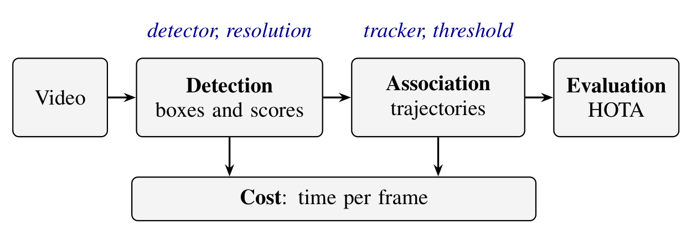

# mot-complementarity

Code and data for the paper *One Configuration Does Not Fit All Videos: Quality and Cost Trade-offs in
Multi-Pedestrian Tracking*.

The study runs a catalog of 108 tracking-by-detection configurations, kept constant over the whole video, on 100
pedestrian videos from five datasets, and compares the best single configuration with the best configuration of each
video (the oracle), the role of each factor in that gap, and the effect of processing cost. A configuration combines a
detector (YOLO26-n, YOLO26-m, D-FINE-L, Faster R-CNN), its input resolution (640, 960, 1280), a tracker (ByteTrack,
OC-SORT, BoT-SORT) and its confidence threshold (0.3, 0.45, 0.6). Quality is HOTA from TrackEval; cost is the mean
processing time per frame of the detector and the tracker.

The runs reported in the paper ship in [`paper_results/`](paper_results/): one table per stage of the three runs of
the experiment (10,800 video x configuration cells each), the scene properties of the videos, and the result tables
computed from them ([`paper_results/analysis/`](paper_results/analysis/)). The result tables are rebuilt from those
files without a GPU; running the experiment regenerates the files themselves (see
[Reproducing the results](#reproducing-the-results)).



*Experimental protocol.*

Developed on Windows 11 with an NVIDIA RTX 4070 Ti SUPER, an AMD Ryzen 9 9900X and 32 GB of RAM.

---

## How it works

One YAML file describes the experiment ([`configs/experiment.yaml`](configs/experiment.yaml), with the catalog in
[`configs/catalog.yaml`](configs/catalog.yaml) and the tracker profiles in [`configs/trackers.yaml`](configs/trackers.yaml)).
The `pedestrian_catalog` package resolves the catalog, runs each stage cell by cell and records every product
addressed by its content, so that a run can be interrupted and resumed at any point. Each detector runs once per video
and resolution; its detections (confidence of at least 0.01) are cached and reused by the nine tracker x threshold
combinations, so the thresholds are applied by the trackers only.

```
python -m pedestrian_catalog run     ->  runs/<run>/detections/   one cell per detector variant x video
                                         runs/<run>/tracks/       one cell per configuration x video
                                         runs/<run>/metrics/      one TrackEval evaluation per tracking cell
python -m pedestrian_catalog export            ->  videos.csv, configurations.csv, quality.csv,
                                                   detection_runs.csv, tracking_runs.csv
python -m pedestrian_catalog scene-properties  ->  scene_properties.csv   (from the annotations and the corpus manifest)
python -m pedestrian_catalog analyze           ->  analysis/*.csv         (the results)
```

```
mot-complementarity/
├── pedestrian_catalog/       # the experiment pipeline (python -m pedestrian_catalog)
│   ├── cli.py                # doctor | inventory | plan | check-options | detect | track | evaluate | run | export
│   │                         #   | scene-properties | analyze
│   ├── corpus.py             # inventory of the videos and the corpus manifest
│   ├── catalog.py            # the declarative catalog: configurations and their content identities
│   ├── options_check.py      # check that every catalog parameter is applied and changes the output
│   ├── detection.py          # detection caches, one cell per detector variant x video
│   ├── tracking.py           # tracks over the caches, one cell per configuration x video
│   ├── evaluation.py         # TrackEval in its own environment, one cell per tracking cell
│   ├── export.py             # the runs to the tables read by the analysis
│   ├── results.py            # loading of the exported tables; cost as the median over runs
│   ├── analysis.py           # the results: gap, origin of the gap, cost and budgets (no GPU)
│   ├── scene.py              # scene properties and their relation to the gain of each choice
│   ├── stats.py              # BCa bootstrap and Holm correction
│   ├── backends/             # adapters of Ultralytics, Hugging Face Transformers, torchvision and BoxMOT
│   └── ...                   # provenance, runtime environment, resources, progress
├── prepare/                  # conversion of CrowdTrack and PersonPath22, camera motion measurement
├── configs/                  # experiment, catalog, tracker profiles, example of the local paths
├── manifests/                # corpus, camera motion, physical groups, PersonPath22 selection, resolved catalog,
│                             # environment and options seal
├── paper_results/            # the exported tables of the three runs and the result tables (analysis/)
├── docs/images/              # the protocol figure
├── tests/                    # unit and integration tests; the default suite needs no GPU, weights or datasets
└── requirements.txt          # pinned versions used for the runs
```

---

## Results (no GPU)

```bash
python -m pedestrian_catalog analyze
```

reads the exported tables in `paper_results/` and writes the result tables in `paper_results/analysis/`. Each video
weighs the same; the fixed configuration is the one with the highest mean HOTA over the videos; the oracle picks the
highest-HOTA configuration on each video, and the gap is the oracle minus the fixed configuration; the 95 % intervals
are BCa over the videos (B = 10,000, seed 42).

| file | content |
|---|---|
| `gap_summary.csv` | HOTA of the fixed configuration and of the oracle, and the gap: over all videos (with its 95 % interval), per dataset, and without MOT20 |
| `gap_by_video.csv` | per video: HOTA of the fixed configuration, the oracle's configuration and HOTA, the gap, and the difference between the two best configurations |
| `fixed_configuration.csv` | the fixed configuration elected on all videos, without each dataset and without each video |
| `coverage.csv` | for each tolerance, the videos on which the fixed configuration, and the best single configuration, are within it of the oracle |
| `option_removal.csv` | the oracle without each option of each factor, and how much it drops |
| `factor_adjustment.csv` | the gain of adjusting one factor of the fixed configuration on each video, and three factors together |
| `option_contrasts.csv` | the mean HOTA gain of each option over another of the same factor, in each combination of the other factors |
| `scene_relations.csv` | the 25 relations between the gain of five choices and five scene properties (Spearman within datasets, permutation p-value, Holm) |
| `scene_choices.csv` | for each choice, the property it relates to most, and its gain in DetA and AssA on each half of that property |
| `configuration_cost.csv` | cost of each configuration in ms per frame: mean over videos, deviation and worst video |
| `budget.csv` | for budgets of 33.3, 40, 50 and 71.4 ms per frame, by the worst-video cost and by the mean cost: the feasible configurations, the fixed configuration and the oracle among them, and the gap |
| `budget_curve.csv` | the gap at every budget at which the feasible configurations change |
| `savings_by_video.csv` | per video, the cheapest configuration with HOTA at least that of the fixed one, and the time it saves |
| `savings_by_tolerance.csv` | the mean cost of the cheapest configuration within a tolerance of the fixed configuration's HOTA |
| `runs.csv` | hours of detection and tracking of each run |
| `summary.csv` | the single values: counts, medians and maxima of the gap, cost of the fixed configuration and of the oracle, ... |
| `inputs.csv` | SHA-256 of the exported tables that were read |

`--results` points the analysis at the export of another experiment, and `--fps` changes the budgets.

### The exported tables

| file | rows | content |
|---|---|---|
| `videos.csv` | 100 | dataset, sequence, frames, frame rate, width, height and physical group of each video |
| `configurations.csv` | 108 | the level of each factor of each configuration and its detector variant |
| `quality.csv` | 10,800 | 20 TrackEval metrics of every video x configuration cell (HOTA, DetA, AssA, LocA, IDF1, MOTA, IDSW, Frag, ...) |
| `detection_runs.csv` | 3 x 1,200 | per run, video and detector variant: detector time per frame (ms) and duration of the call (s) |
| `tracking_runs.csv` | 3 x 10,800 | per run, video and configuration: tracker time per frame (ms) and duration of the call (s) |
| `scene_properties.csv` | 100 | density, overlap, person size, camera motion and pedestrian motion of each video |

The quality metrics were identical in every cell of the three runs, so `quality.csv` holds one copy. The cost of a
configuration on a video is the detector time per frame of its detector variant plus its tracker time per frame; the
analysis takes, in each cell, the median over the three runs. Detector time covers preprocessing, inference and
postprocessing up to the output on the CPU; tracker time covers association and, in BoT-SORT, re-identification and
camera motion compensation; reading and decoding the frame are excluded.

---

## Installation

### 1. Main environment (Python 3.11)

```powershell
git clone https://github.com/Pedro-Manoel/mot-complementarity.git
cd mot-complementarity
py -3.11 -m venv .venv
.venv\Scripts\activate
pip install torch==2.8.0 torchvision==0.23.0 --index-url https://download.pytorch.org/whl/cu129
pip install -r requirements.txt
pip install --force-reinstall --no-deps lap==0.5.13
```

Install PyTorch first: the PyPI wheel is CPU-only. BoxMOT depends on `lapx`, which installs the same `lap` module as
`lap`; the published runs used the files of `lap` 0.5.13, hence the last line. On Linux, use `python3.11 -m venv .venv`
and `source .venv/bin/activate`. Run every command from the repository root.

Rebuilding the result tables from `paper_results/` (`analyze`) needs only numpy, pandas, scipy and PyYAML.

### 2. TrackEval (separate environment, Python 3.8)

TrackEval runs unchanged in its own environment and is called as a subprocess.

```powershell
git clone https://github.com/JonathonLuiten/TrackEval.git
git -C TrackEval checkout 12c8791b303e0a0b50f753af204249e622d0281a
py -3.8 -m venv .venvs\trackeval
.venvs\trackeval\Scripts\pip install numpy==1.23.5 scipy==1.10.1
.venvs\trackeval\Scripts\pip install -e TrackEval\
```

### 3. Datasets

The datasets are not redistributed here. They are read in MOTChallenge format from `data_root`
([`configs/paths.example.yaml`](configs/paths.example.yaml)):

```
<data_root>/
├── MOT17/train/MOT17-02-FRCNN/       seqinfo.ini, img1/, gt/gt.txt   (7 FRCNN sequences)
├── MOT20/train/MOT20-01/             (4 sequences)
├── SOMPT22/train/SOMPT22-02/         (9 sequences)
├── CrowdTrack-person/track0001/      (33 sequences, converted)
└── PersonPath22/seqs/PersonPath22-00012/   (47 selected videos, converted)
```

- MOT17 and MOT20 from [MOTChallenge](https://motchallenge.net/), train splits; MOT17 ships each sequence three times
  with the same frames and ground truth, and the inventory keeps the FRCNN copy.
- SOMPT22 from its [project page](https://sompt22.github.io/), train split.
- CrowdTrack from its authors ([arXiv:2507.02479](https://arxiv.org/abs/2507.02479)), converted with
  `python prepare/crowdtrack_to_mot.py --input-root <CrowdTrack> --output-root <data_root>/CrowdTrack-person`
  (the converter writes the frame rate of the CrowdTrack paper, 20 fps). The converter expects each sequence folder to
  hold its frames and annotations directly; if a folder contains a nested folder with the same name (track0010 in our
  copy), move its contents up one level first.
- PersonPath22 from the [Amazon Science release](https://github.com/amazon-science/tracking-dataset), converted with
  `python prepare/personpath22_to_mot.py --dataset-root <personpath22> --output-root <data_root>/PersonPath22/seqs`.
  Only the 47 videos of [`manifests/personpath22_selection.csv`](manifests/personpath22_selection.csv) are
  converted: one video per physical camera, drawn with seed 42. Its annotations cover people on keyframes only; the
  converter marks the other frames as ignore regions and the evaluation uses the PersonPath22 class of TrackEval.

[`manifests/corpus.csv`](manifests/corpus.csv) holds the SHA-256 of the ground truth and a fingerprint of the frames of
each video; `inventory` writes the same columns for the local data, so the two can be compared.

### 4. Weights

| detector | weights |
|---|---|
| YOLO26-n, YOLO26-m | `yolo26n.pt`, `yolo26m.pt` from Ultralytics, in `weights_dir` |
| D-FINE-L | `ustc-community/dfine-large-coco` from Hugging Face, revision `aa8f8211545e4cff5adf52ea512f9ac74a9824ec`, in the local Hugging Face cache |
| Faster R-CNN | torchvision `FasterRCNN_ResNet50_FPN_V2_Weights.COCO_V1` (`fasterrcnn_resnet50_fpn_v2_coco-dd69338a.pth`), in the torch hub cache |
| BoT-SORT ReID | `osnet_x0_25_msmt17.pt` from BoxMOT, in `weights_dir` |

The package never downloads weights. They can be obtained with the libraries themselves:

```powershell
# YOLO26: downloaded to the current folder; move both files to weights_dir
python -c "from ultralytics import YOLO; YOLO('yolo26n.pt'); YOLO('yolo26m.pt')"
# D-FINE-L: the three files of the recorded revision, into hf_cache_dir
python -c "from huggingface_hub import snapshot_download as d; d('ustc-community/dfine-large-coco', revision='aa8f8211545e4cff5adf52ea512f9ac74a9824ec', allow_patterns=['config.json', 'model.safetensors', 'preprocessor_config.json'], cache_dir=r'<hf_cache_dir>')"
# Faster R-CNN: into <torch_hub_dir>/checkpoints
python -c "import torch, torchvision; torch.hub.set_dir(r'<torch_hub_dir>'); torchvision.models.detection.FasterRCNN_ResNet50_FPN_V2_Weights.COCO_V1.get_state_dict(progress=True)"
# OSNet ReID: the file BoxMOT 17.0.0 points to, into weights_dir
python -c "import gdown; gdown.download('https://drive.google.com/uc?id=1sSwXSUlj4_tHZequ_iZ8w_Jh0VaRQMqF', r'<weights_dir>/osnet_x0_25_msmt17.pt')"
```

`plan` records the SHA-256 of each file in [`manifests/catalog.resolved.json`](manifests/catalog.resolved.json), and
`detect` and `track` refuse weights whose hash differs from that record. Comparing the file `plan` writes with the
published one (`git diff manifests/catalog.resolved.json`) shows whether the local weights are the ones of the runs.

---

## Reproducing the results

```powershell
copy configs\paths.example.yaml configs\paths.local.yaml      # then edit the paths

# 0. Environment: library versions, GPU, TrackEval in its environment
python -m pedestrian_catalog doctor

# 1. Corpus manifest from the local data (compare it with manifests/corpus.csv), resolved catalog and options seal.
#    The camera motion of each video is in manifests/camera_motion.csv; prepare/camera_motion.py measures it again.
python prepare/camera_motion.py --paths configs/paths.local.yaml
python -m pedestrian_catalog inventory --out runs/corpus_local.csv
python -m pedestrian_catalog plan
python -m pedestrian_catalog check-options --device cpu
git diff manifests/      # environment, camera motion, weights and seal of this machine against the published ones

# 2. The three runs: detection, tracking and evaluation of the 10,800 cells; detection and tracking took about 60 hours
#    per run on the hardware above, and evaluation less than one more
python -m pedestrian_catalog run --run-id run1 --device cuda:0
python -m pedestrian_catalog run --run-id run2 --device cuda:0
python -m pedestrian_catalog run --run-id run3 --device cuda:0

# 3. Export, scene properties and the results (no GPU)
python -m pedestrian_catalog export --run-id run1 run2 run3 --out results/rerun
python -m pedestrian_catalog scene-properties --out results/rerun/scene_properties.csv
python -m pedestrian_catalog analyze --results results/rerun
```

Then compare `results/rerun/` with `paper_results/`. In the published runs the quality metrics were identical in every
cell of the three runs; times depend on the hardware and on the load of the machine (the typical difference between the
fastest and the slowest of the three runs of a cell was 11 %).

`run` executes detect (one process per detector, so that one model is loaded per process), track and evaluate in
child processes, stopping at the first stage that fails; repeating the same command resumes, because every stage skips
the complete cells. The stages can also be run one by one with the same `--run-id`: `detect` and `track` take
`--device`, and `--detectors` (detect), `--configs` (track, evaluate) and `--sequences` restrict them. Nothing uses the
GPU without `--device cuda:...`, and the commands that use it take a lock in `runs/.gpu.lock`. The output of each stage
goes to `runs/<run>/logs/`.

`check-options` loads the real weights (on the CPU) and verifies what the catalog states as rules: every detector level
reaches the network, the confidence floor and the box limit change the output (for D-FINE the limit is the number of
queries of the checkpoint, and is checked against it), two levels never give the same output, every tracker field
changes the tracks and the fields declared as having no effect still have none. `detect` and `track` refuse to start
without an approved seal for the current catalog and library versions;
[`manifests/option_check.json`](manifests/option_check.json) is the seal for this catalog and the library versions of
the published runs.

---

## Reproducibility notes

- **Cost.** The cost of a cell is the sum of the mean detector time per frame and the mean tracker time per frame,
  measured in the same loop that produced the caches and the tracks, one model per process. Detection runs once per
  detector variant and video and is shared by the nine tracker x threshold combinations.
- **CrowdTrack frame rate.** CrowdTrack is used at 20 fps, the rate reported by its authors; it enters the trackers
  through the lost-track time (1 s, that is, 20 frames).
- **PersonPath22.** HOTA is computed on the annotated keyframes only, with the PersonPath22 class of TrackEval, which
  treats class 13 as an ignore region. `inventory` refuses a PersonPath22 sequence whose `seqinfo.ini` does not declare
  that class.
- **Ground truth after the last frame.** CrowdTrack track0004 has 141 annotation rows after its last frame; they are kept
  in the manifest count and left out of the evaluation.
- **Tracker parameters.** Each tracker uses the BoxMOT defaults of its family, except the three parameters common to all
  of them: the confidence threshold (the factor), the lost-track time (1 s) and the confirmation (2 frames).
  `backends/trackers.py` translates them into each family's constructor arguments and reads them back from the instance.
- **Determinism.** Detection on the GPU is not guaranteed to be bit-identical across hardware or library versions; on
  the machine of the published runs the three runs produced the same detections and metrics in every cell.

---

## Tests

```bash
python -m pytest -q                 # no GPU, no weights, no datasets
python -m pytest -q -m weights      # with the real weights and datasets of configs/paths.local.yaml, on the CPU
```

---

## Citation

If you use this code or these results, please cite:

> P. M. H. Alves, C. de S. Baptista, and D. C. G. Valadares, "One Configuration Does Not Fit All Videos: Quality and
> Cost Trade-offs in Multi-Pedestrian Tracking," in *Proc. IEEE Int. Symp. Multimedia (ISM)*, 2026.

## License

MIT License; see [LICENSE](LICENSE). The datasets, the weights and TrackEval keep their own licenses.
